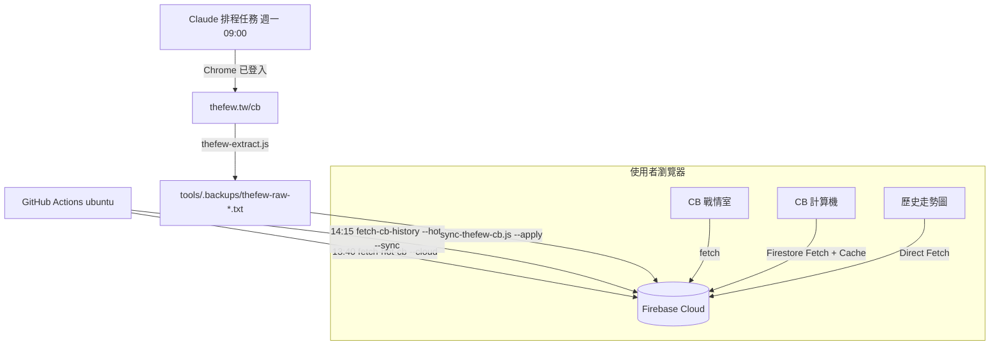

# CB 爬蟲資料流架構 (CB Crawler Data Flow Architecture)

> **最後更新日期**: 2026-11-03
> **狀態**: Production Ready (V1.9 — 停用 XQ DDE 軌，改為每週 thefew 同步；歷史同步只跑熱門 Top 20)

本文件詳細記錄了「可轉債 (CB) 戰情室」與「計算機」背後的自動化資料流架構。此系統採用 **雙軌並行 (Dual Track)** 策略，確保熱門數據的即時性，同時維持全市場搜索的完整性。

## 核心策略：雙軌分流 (Dual Track Strategy)

為了解決單一檔案無法同時滿足「精簡熱門排行」與「完整市場搜尋」的矛盾，我們將資料流拆分為兩條獨立路徑：

### 1. 路徑 A：戰情室熱門清單 (Hot List) 🏎️

- **目標檔案**: `public/data/hot-cb.json`
- **內容**: 嚴格篩選的 **Top 20** 成交量熱門可轉債。
- **資料特性**:
  - **輕量**: 檔案極小，前端載入無負擔。
  - **即時**: 僅包含當日有交易且成功抓取到價格的標的，保證無 `NaN`。
- **用途**: 專供 `cb-war-room.html` (戰情室) 顯示。

### 2. 路徑 B：全市場搜尋目錄 (Master Directory) 📖

- **主要來源**: **Firestore (`cb_history` collection)**
- **內容**: 市場上 **300+ 檔** 所有可轉債的總集。
- **資料特性**:
  - **解耦**: `cb-data.json` 不再進入 Git 倉庫，作為 **CLI 工具鍊的本地快取 (Local Cache)**，供後端維護腳本使用。
  - **權威性**: 前端計算機 (`cb-calculator.html`) 直接查詢 Firestore，**不再依賴此檔案**。
  - **即時**: 每次同步後，Firestore 即為權威版本，前端無需等待部署即可讀取。
  - **風險管理**：
    - **離線支援**：實作前端 `LocalStorage` 緩存，確保在斷網時仍能使用搜尋功能。
    - **費用控制**：僅在緩存過期（1 小時）或手動強制重新載入時才 Fetch Firestore，極小化雲端讀取成本。
- **用途**: 供 `backfill-to-firebase.js` 等 CLI 維護工具查詢中繼資料。

## 自動化循環 (The Automation Loop)

自動化分為**兩條軌道**：

### ☁️ 軌道一：GitHub Actions（雲端，每交易日自動）

平台無關，跑在 GitHub 的 ubuntu runner 上，憑證來自 repo secrets（`FIREBASE_SERVICE_ACCOUNT`）。

| Workflow | 排程 (UTC+8) | 執行內容 |
| --- | --- | --- |
| `daily-hot-cb.yml` | 週一至五 13:40（收盤後） | `node tools/fetch-hot-cb.js --cloud` 抓熱門清單上雲 |
| `daily-cb-history.yml` | 週一至五 14:15（行情更新後） | `node tools/fetch-cb-history.js --hot --smart --sync` 只補**最新熱門榜 Top 20** 的歷史資料 |

- **`--hot`**：目標清單取自 `hot_cb_meta/latest` 指向的 `hot_cb_snapshots/{日期}`，不再每天跑全部 CB（2026-11-03 起，原本是 `--all`）。
- **抓取起點**：本地無檔時先讀雲端 `cb_history/{code}` 主文件的 `lastRecordDate`，從那一筆的當月抓起；雲端也沒有這檔（且沒在指令列指名）就整檔跳過。
- **寫入範圍**：只寫 `date >= lastRecordDate` 的 records，舊日期不重寫，省 Firestore 寫入次數；寫完回填主文件的 `lastRecordDate`。
- **舊資料相容**：主文件還沒有 `lastRecordDate` 時，改查 `records` 依 `date` 降冪取一筆，只多一次讀取。

兩者皆支援 `workflow_dispatch` 手動補跑。健康檢查：`gh run list --workflow=daily-hot-cb.yml --limit 5`。

### 🗓️ 軌道二：每週 thefew 同步（Claude 排程任務，週一 09:00）

主文件的**轉換價、CB 收盤價、股票收盤價**每週更新一次，不每天維護全部 CB。

- **來源**：[thefew.tw/cb](https://thefew.tw/cb) 可轉債列表的「轉換價」（已含除權息調整）、「CB收盤價」、「股票收盤價」。數字要登入才看得到，所以不走 Actions，改由 Claude 排程任務 `weekly-thefew-cb-sync` 用使用者已登入的 Chrome 抓取。前提：那個時間 Mac 與 Chrome 開著、Claude in Chrome 擴充功能連線中；沒跑到時在 app 的排程頁按「Run now」補跑。
- **流程**：
  1. 在 thefew 列表頁執行 `tools/thefew-extract.js`，結果分段取出存成 `tools/.backups/thefew-raw-YYYY-MM-DD.txt`
  2. `node tools/sync-thefew-cb.js <檔案>` dry-run，再加 `--apply` 寫入
- **寫入欄位**：`conversionPrice`、`price`（CB 收盤價）、`stockPrice`、`priceDate`。計算機選標的時帶入這些值並顯示價格日期，價格舊了可手動改輸入框。
- **防呆**：解析筆數少於 300 整批不寫；轉換價單檔變動超過 30% 不寫，列出來人工確認；寫入前舊值備份到 `tools/.backups/thefew-YYYY-MM-DD.json`（已 gitignore）。
- **範圍**：只更新 thefew 列表上有、且 `cb_history` 已存在的代號；不自動新增標的，已到期下市的舊文件不動。

### 已停用：Windows XQ DDE 軌（2026-11-03）

原本由 Windows 交易機的 Task Scheduler（週一 10:00／週五 14:00）跑 `CB_Sync_Master.bat` → `xq_bridge.py`，從 XQ DDE 寫入全部 CB 的價格與轉換價。XQ 回傳的數值會被截掉一位數（例：家登五轉換價 488.9 存成 48、群聯股價 1875 存成 184），寫壞上百檔，因此停用。相關腳本與 Excel／CSV 匯入工具已移到 `tools/archive/deprecated/xq-dde/`。

## 架構視覺化 (Architecture Diagram)



## 檔案結構說明

```text
/public/data/
├── hot-cb.json       # [Ignored] 熱門清單
├── cb-data.json      # [Ignored] 市場全集 (僅供本地快取)
└── history/          # [Deprecated] 舊版歷史資料夾
```
