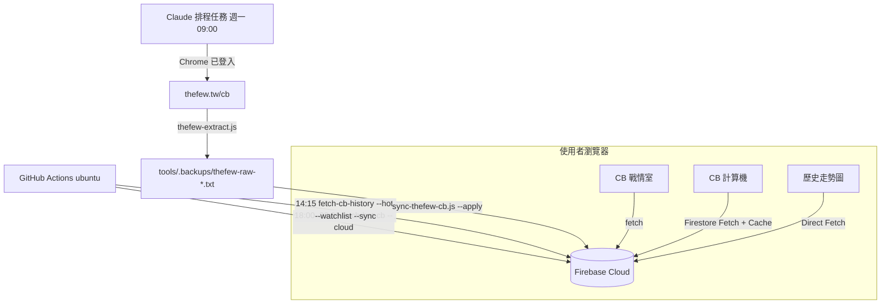

# CB 爬蟲資料流架構 (CB Crawler Data Flow Architecture)

> **最後更新日期**: 2026-11-03
> **狀態**: Production Ready (V2.0 — 歷史同步改跑熱門 Top 20 + 我的追蹤，主文件新增 `daily` 當日欄位)

本文件詳細記錄了「可轉債 (CB) 戰情室」與「計算機」背後的自動化資料流架構。此系統採用 **雙軌並行 (Dual Track)** 策略，確保熱門數據的即時性，同時維持全市場搜索的完整性。

## 核心策略：雙軌分流 (Dual Track Strategy)

為了解決單一檔案無法同時滿足「精簡熱門排行」與「完整市場搜尋」的矛盾，我們將資料流拆分為兩條獨立路徑：

### 1. 路徑 A：戰情室熱門清單 (Hot List) 🏎️

- **目標檔案**: `public/data/hot-cb.json`
- **內容**: 嚴格篩選的 **Top 20** 成交量熱門可轉債。
- **資料特性**:
  - **輕量**: 檔案極小，前端載入無負擔。
  - **即時**: 僅包含當日有交易且成功抓取到價格的標的，保證無 `NaN`。
- **用途**: 專供 `cb-war-room.html` (戰情室) 顯示。

### 2. 路徑 B：全市場搜尋目錄 (Master Directory) 📖

- **主要來源**: **Firestore (`cb_history` collection)**
- **內容**: 市場上 **300+ 檔** 所有可轉債的總集。
- **資料特性**:
  - **解耦**: `cb-data.json` 不再進入 Git 倉庫，作為 **CLI 工具鍊的本地快取 (Local Cache)**，供後端維護腳本使用。
  - **權威性**: 前端計算機 (`cb-calculator.html`) 直接查詢 Firestore，**不再依賴此檔案**。
  - **即時**: 每次同步後，Firestore 即為權威版本，前端無需等待部署即可讀取。
  - **風險管理**：
    - **離線支援**：實作前端 `LocalStorage` 緩存，確保在斷網時仍能使用搜尋功能。
    - **費用控制**：僅在緩存過期（1 小時）或手動強制重新載入時才 Fetch Firestore，極小化雲端讀取成本。
- **用途**: 供 `backfill-to-firebase.js` 等 CLI 維護工具查詢中繼資料。

## 自動化循環 (The Automation Loop)

自動化分為**兩條軌道**：

### ☁️ 軌道一：GitHub Actions（雲端，每交易日自動）

平台無關，跑在 GitHub 的 ubuntu runner 上，憑證來自 repo secrets（`FIREBASE_SERVICE_ACCOUNT`）。service account 不受 Firestore 規則限制；前端只有站主登入後能寫 `cb_history`（2026-11-04 起，見 `firebase/firestore.rules`）。Workflow 只給 `contents: read` 權限、action 鎖定 commit SHA、用 `npm ci` 照 lockfile 安裝。

| Workflow | 排程 (UTC+8) | 執行內容 |
| --- | --- | --- |
| `daily-hot-cb.yml` | 週一至五 18:00、20:00、22:30（櫃買當日檔約 17:20 出） | `node tools/fetch-hot-cb.js --cloud` 讀櫃買每日可轉債行情 CSV，成交張數前 20 名存成當天快照 |
| `daily-cb-history.yml` | 週一至五 14:15（行情更新後） | `node tools/fetch-cb-history.js --hot --watchlist --smart --sync` 補**熱門榜 Top 20 + 我的追蹤**的歷史資料，並寫入主文件 `daily` |

- **`--hot`**：目標清單取自文件 ID（日期）最新的 `hot_cb_snapshots/{日期}`，不再每天跑全部 CB（2026-11-03 起，原本是 `--all`）。2026-11-10 起不再讀 `hot_cb_meta/latest`：當天的錯誤快照被刪掉後，指標仍指向已刪除的文件，整個同步失敗。
- **`--watchlist`**：再併入「我的追蹤」＝ `cb_history` 中 `category` 非空的主文件（與前端 `useWatchlist` 同條件），兩者取聯集。單獨使用、不加 `--sync` 時可當本機 dry-run：`node tools/fetch-cb-history.js --watchlist 2026-11-01` 只抓 11 月起、印出每檔的 `daily`。
- **資料來源**：CB 取 TPEx `cbDayQry` 的「等價」列（收市價、漲跌、單位）；現股先試 TWSE `STOCK_DAY`，查無再改 TPEx `afterTrading/tradingStock`（舊的 `st43_result.php` 已 404）。皆為免登入公開資料。
- **抓取起點**：本地無檔時先讀雲端 `cb_history/{code}` 主文件的 `lastRecordDate`，從那一筆的當月抓起；雲端也沒有這檔（且沒在指令列指名）就整檔跳過。
- **寫入範圍**：只寫 `date >= lastRecordDate` 的 records，舊日期不重寫，省 Firestore 寫入次數；寫完回填主文件的 `lastRecordDate`。
- **舊資料相容**：主文件還沒有 `lastRecordDate` 時，改查 `records` 依 `date` 降冪取一筆，只多一次讀取。

- **熱門榜快照 ID 用資料交易日（2026-11-10 起）**：抓到哪一天的檔就寫成那一天的快照，該日已有快照就跳過，前一天的資料不會被存成今天；排程延遲到過午夜也照樣補寫前一天，不會漏。三次排程中，先抓到當天檔的寫入，後面跳過；只有寫入新快照時才更新 `cb_history` 主文件。22:30 那次加 `--final`，還沒有這一輪的檔就失敗並發 Telegram（休市日也會發）；「這一輪」指台北時間往前推 12 小時的日期，所以拖到隔天中午前跑也不會誤報。GitHub 排程常延遲數小時，偶爾漏跑，可手動補跑。

- **櫃買回 403 時重試（2026-11-12 起）**：櫃買偶爾對某台 GitHub 機器回 403（拒絕存取），換到下一次排程的機器通常就恢復。`src/utils/cb-fetcher.js` 遇到 403 每 30 秒重試一次、最多 3 次，仍被擋就直接失敗，錯誤訊息寫「櫃買拒絕連線 (HTTP 403)」；不再把 403 當成那天沒檔、往前翻 10 天，以免誤報成「最近 10 天都抓不到櫃買可轉債報價檔」。

兩者皆支援 `workflow_dispatch` 手動補跑。

- **失敗通知（2026-11-06 起）**：任何一步失敗，最後一步用 repo secrets `TELEGRAM_BOT_TOKEN` / `TELEGRAM_CHAT_ID`（與 second-brain 同一個 bot）發 Telegram，附執行紀錄連結；secrets 沒設就略過。訊息內容是主步驟 log（`run.log`）中最後 5 行含 `❌`、`🛑`、`Error` 的錯誤行（2026-11-10 起，原本是固定的「可能是額度用完」），log 有 `RESOURCE_EXHAUSTED` 時另加額度用完的提示。`fetch-cb-history.js` 在 Firestore 額度用完或任一檔寫入失敗時、`fetch-hot-cb.js` 在抓熱門榜失敗、或最後一次排程仍沒有今天的檔時，都會以非 0 結束。專案已停用計費、改用免費額度，額度用完不會收費，也不會有 Google 通知，見 `docs/gcp_billing_audit_20260428.md` 第 6 節。

#### 主文件 `daily` 欄位（前端「我的追蹤」直接讀）

每次同步一檔時，用抓到的最新一筆 record 組出 `cb_history/{code}.daily`，與 `lastRecordDate` 同一次寫入，不多花寫入次數。

| 欄位 | 型別 | 說明 |
| --- | --- | --- |
| `date` | string `YYYY-MM-DD` | 資料所屬交易日 |
| `cbClose` | number \| null | CB 收市價（等價）；當天沒成交為 `null` |
| `cbChange` | number \| null | CB 漲跌（元），來源直接給的值 |
| `cbVolume` | number \| null | CB 成交張數（等價「單位」）；`0` = 沒成交；`null` = 抓不到當天 CB 資料 |
| `traded` | boolean \| null | `cbVolume > 0`；`null` = 不確定 |
| `stockClose` | number \| null | 現股收盤價 |
| `stockChange` | number \| null | 現股漲跌（元）；除權息日來源為 `X0.00`，存成 `0` |
| `conversionPrice` | number \| null | 計算溢價率用的轉換價（取自主文件，每週 thefew 同步） |
| `premium` | number \| null | 轉換溢價率 %，`(cbClose − 100/轉換價 × stockClose) ÷ 平價 × 100`，小數兩位；任一值缺就是 `null` |
| `updatedAt` | string ISO 8601 | 寫入時間 |

- 漲跌幅 % 由前端算：`cbChange ÷ (cbClose − cbChange)`。
- 沒成交時 `cbClose`、`premium` 為 `null`，前端要顯示「未成交」，參考價可用主文件 `price`（每週 thefew）。
- 主文件原有的 `price`、`stockPrice`、`priceDate` 仍只由每週 thefew 同步寫入，`daily` 不動它們。
- `records/{date}` 也新增 `cbChange`、`cbVolume`、`stockChange` 欄位。2026-11-03 前的 `cbPrice` 誤取「最低價」欄，之後才是收市價。健康檢查：`gh run list --workflow=daily-hot-cb.yml --limit 5`。

### 🗓️ 軌道二：每週 thefew 同步（Claude 排程任務，週一 09:00）

主文件的**轉換價、CB 收盤價、股票收盤價**每週更新一次，不每天維護全部 CB。

- **來源**：[thefew.tw/cb](https://thefew.tw/cb) 可轉債列表的「轉換價」（已含除權息調整）、「CB收盤價」、「股票收盤價」。數字要登入才看得到，所以不走 Actions，改由 Claude 排程任務 `weekly-thefew-cb-sync` 用使用者已登入的 Chrome 抓取。前提：那個時間 Mac 與 Chrome 開著、Claude in Chrome 擴充功能連線中；沒跑到時在 app 的排程頁按「Run now」補跑。
- **流程**：
  1. 在 thefew 列表頁執行 `tools/thefew-extract.js`，結果分段取出存成 `tools/.backups/thefew-raw-YYYY-MM-DD.txt`
  2. `node tools/sync-thefew-cb.js <檔案>` dry-run，再加 `--apply` 寫入
- **寫入欄位**：`conversionPrice`、`price`（CB 收盤價）、`stockPrice`、`priceDate`。計算機選標的時帶入這些值並顯示價格日期，價格舊了可手動改輸入框。
- **防呆**：解析筆數少於 300 整批不寫；轉換價單檔變動超過 30% 不寫，列出來人工確認；寫入前舊值備份到 `tools/.backups/thefew-YYYY-MM-DD.json`（已 gitignore）。
- **範圍**：只更新 thefew 列表上有、且 `cb_history` 已存在的代號；不自動新增標的，已到期下市的舊文件不動。

### 已停用：Windows XQ DDE 軌（2026-11-03）

原本由 Windows 交易機的 Task Scheduler（週一 10:00／週五 14:00）跑 `CB_Sync_Master.bat` → `xq_bridge.py`，從 XQ DDE 寫入全部 CB 的價格與轉換價。XQ 回傳的數值會被截掉一位數（例：家登五轉換價 488.9 存成 48、群聯股價 1875 存成 184），寫壞上百檔，因此停用。相關腳本與 Excel／CSV 匯入工具已移到 `tools/archive/deprecated/xq-dde/`。

## 架構視覺化 (Architecture Diagram)



## 檔案結構說明

```text
/public/data/
├── hot-cb.json       # [Ignored] 熱門清單
├── cb-data.json      # [Ignored] 市場全集 (僅供本地快取)
└── history/          # [Deprecated] 舊版歷史資料夾
```
